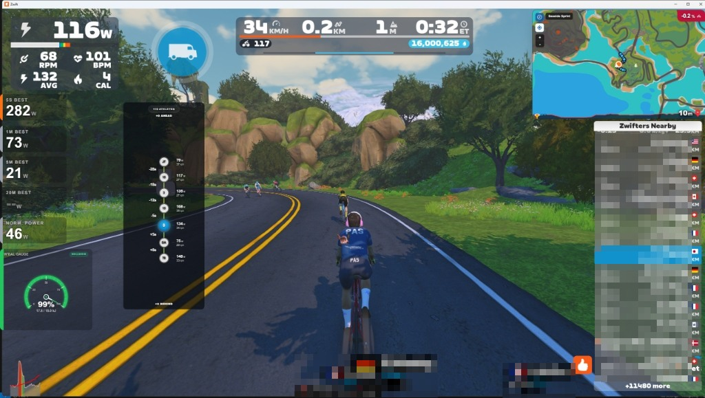
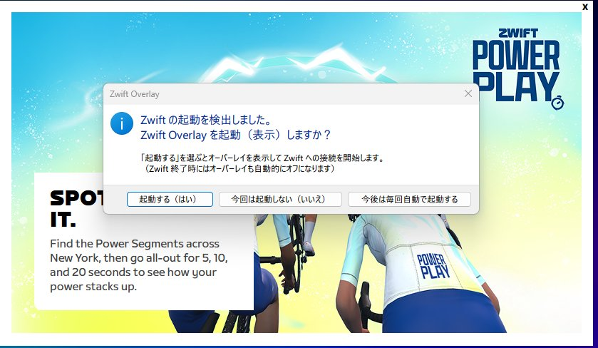
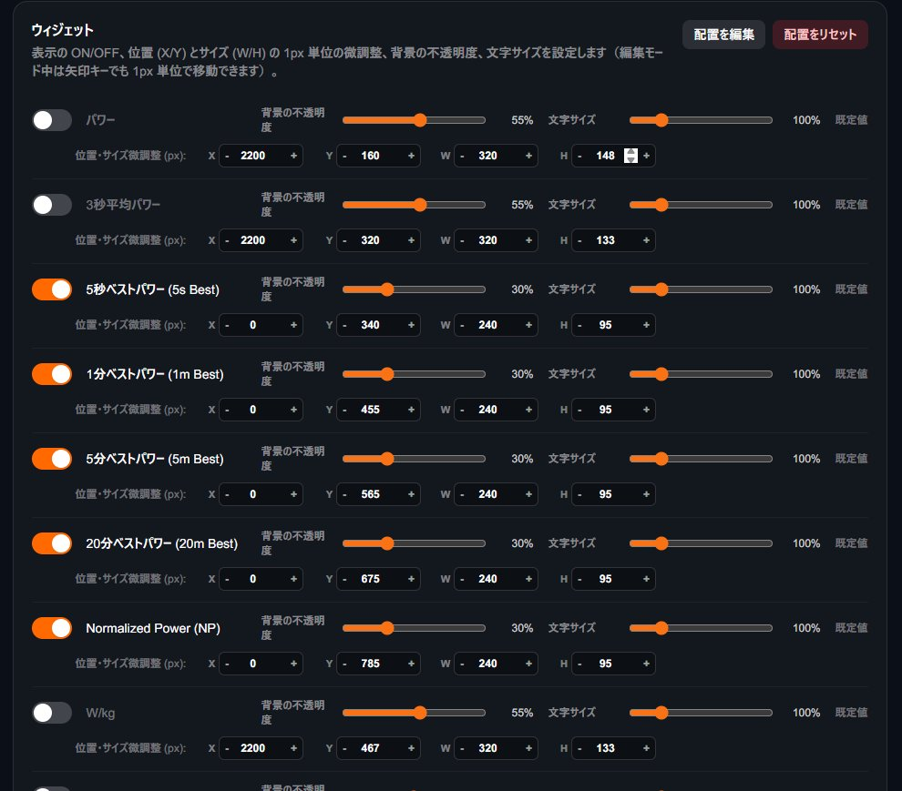

# Zwift Overlay (v0.1.1)

Windows 向けのカスタマイズ可能な Zwift 用リアルタイム HUD オーバーレイアプリです。
Electron + TypeScript + React + Tailwind CSS で構築されており、Zwift の画面上に Best Effort パワー・Normalized Power・W'bal タコメーター・集団タイムギャップ（Mind the Gap）・コース全体の高低差プロファイル付きインタラクティブマップを重ねて表示できます。



---

## 主な機能

- ライド中の Best Effort & Normalized Power（デフォルト ON）
  - 5秒 / 1分 / 5分 / 20分のライド中ベストパワー（Best Effort）
  - ライド全体の Normalized Power（NP / Coggan 定義）
- W'bal タコメーター（デフォルト ON）
  - Skiba 微分法による無酸素仕事容量（W'）のリアルタイム残量をタコメーター形式で可視化（50%超: 緑 / 20%超50%以下: 黄 / 20%以下: 赤）
- グループギャップ（Mind the Gap / デフォルト ON）
  - 前後の集団・単独ライダーとのタイム差、集団人数、平均パワー・速度を縦軸タイムラインで表示
- インタラクティブマップ & コース全体高低差プロファイル（デフォルト ON）
  - 全13ワールドの高解像度マップと全386コースの全体標高断面に対応
  - 現在走行中のコース全体プロファイル上に現在地ピン・走行済み区間・周囲ライダー位置を表示（同一セグメントを繰り返す周回コースでも別周回へワープせず安定追従）
  - 走行軌跡表示モードを切り替え可能（ライド全体 / 直近 5 分 / 直近 3 分 / 非表示）
  - ドラッグによるパン、ズーム、自動追従 / ヘディングアップ切替に対応
- オプションの基本メトリクスウィジェット（初期状態 OFF）
  - Zwift 標準表示で事足りるパワー（瞬時 / 3秒平均）・W/kg・心拍数・ケイデンス・パワーゾーンバー・ラップ集計も、必要に応じて設定画面から ON にできます
- 自由なレイアウトカスタマイズ & マルチディスプレイ対応
  - 各ウィジェットの表示 ON/OFF、背景不透明度、文字サイズ、ドラッグ＆リサイズに対応
  - 編集モード中の矢印キー（1px / Shift+矢印で 10px）および設定画面の数値入力による 1px 単位の位置・サイズ微調整
  - 解像度や DPI スケールが異なるマルチディスプレイ環境でも対象モニタ全体へ正確にフィット
- Zwift 連動の自動起動・自動終了・セッション自動リセット
  - システムトレイに常駐し、Zwift 起動を検知するとオーバーレイを起動するか確認ダイアログ（Ask）を表示（自動起動 / 常時表示も選択可）
  - Zwift アプリ終了時にオーバーレイを自動でオフにし、同日に複数回ライドを行う際も前回ライドの座標や Best Power を自動でリセット（起動直後は Watopia メインスタートゲート前・パワーブランク状態で待機）
  - 設定ウィンドウを閉じたときにアプリ自体を終了するオプションも搭載



---

## 動作環境

- OS: Windows 10 / 11 (64-bit)
- Zwift: 画面モードを「ウィンドウ」または「ボーダーレスウィンドウ」に設定してください
  - 排他的フルスクリーンでは Windows の仕様上、他アプリのオーバーレイを前面に表示できません。

---

## インストール方法

### 方法1: インストーラーから導入する（推奨）

1. 本リポジトリの Releases ページから最新の `Zwift-Overlay-Setup-0.1.1.exe` をダウンロードします。
2. インストーラーを実行してインストールします。
3. スタートメニューまたはデスクトップの「Zwift Overlay」から起動します。

### 方法2: ソースコードからビルド・起動する

Node.js 20 以上が必要です。

```powershell
git clone https://github.com/<your-username>/zwift-overlay.git
cd zwift-overlay
npm install
```

開発モードで起動する場合:

```powershell
npm run dev
```

本番ビルドおよび Windows インストーラー（`dist/Zwift Overlay-Setup-0.1.1.exe`）を作成する場合:

```powershell
npm run dist
```

---

## How to Use（使い方）

### 1. Zwift の表示モードを確認する
Zwift 内の設定画面でディスプレイモードを「ウィンドウ（Windowed）」または「ボーダーレスウィンドウ」にします。

### 2. データソースを設定する
タスクバーのシステムトレイ（通知領域）にある Zwift Overlay アイコンを右クリックして「設定を開く」（またはショートカット `Ctrl+Alt+S`）を開き、「データソース / ライド」セクションを設定します。

- 方式B-1: Zwift ライブ通信（Relay API / Sauce 方式・遅延ゼロ）
  - Zwift 公式 Relay サーバー経由で遅延ゼロのリアルタイムデータ（パワー・心拍・ケイデンス・周囲ライダー・コース情報）を取得します。
  - 観戦用（Monitor）の無料サブアカウントのメールアドレスとパスワードを入力して「接続する」を押してください。
    - メインアカウントと同一のアカウントを使うと Zwift 側の同時ログイン制限で切断されることがあるため、観戦用の無料アカウント（課金不要）を別途作成することを推奨します。
  - 「対象 Player ID」は空欄のままでローカルの Zwift ログからメインアカウントの ID が自動検出されます。

### 3. アスリート設定を行う
「アスリート」セクションで以下の3項目を設定します。

- FTP (W): パワーゾーン判定および W'bal 計算の基準になります。
- 体重 (kg): W/kg 計算に使用します。
- W' (J): W'bal タコメーターの無酸素仕事容量（既定 20,000 J = 20 kJ）を設定します。

### 4. ウィジェットの表示・配置をカスタマイズする



1. 設定画面の「ウィジェット」一覧で表示したい項目のトグルを ON/OFF します。
   - デフォルトでは Zwift 標準表示と重複しない実用ウィジェット（5s / 1m / 5m / 20m Best、NP、W'bal、Mind the Gap、インタラクティブマップ）が ON になっています。
   - 「インタラクティブマップ」の行では、走行軌跡の表示モード（ライド全体 / 直近 5 分 / 直近 3 分 / 非表示）も切り替えられます。
2. 各ウィジェットの「背景の不透明度」「文字サイズ」「位置・サイズ微調整 (X / Y / W / H)」をリアルタイムに調整できます。
3. 「配置を編集」ボタン（または `Ctrl+Alt+E`）を押すと編集モードに入り、オーバーレイ上で直接ドラッグ移動・リサイズができます。
   - 選択中のウィジェットはキーボードの矢印キーで 1px 単位（`Shift` + 矢印キーで 10px 単位、`Alt` + 矢印キーでサイズ 1px 単位）の微調整が可能です。
   - 編集が終わったら `Esc` または `Ctrl+Alt+E` でロックモード（クリックスルー状態）に戻ります。

### 5. Zwift 連動・終了オプションを設定する
「オーバーレイ」セクションで普段の使い方に合わせた動作を選べます。

- Zwift 起動時の動作
  - 確認する (Ask): Zwift 起動を検出した際に「起動しますか？」ダイアログを表示します。
  - 自動表示 (Auto): Zwift 起動と同時にオーバーレイを自動表示します。
  - 常時表示 (Always): Zwift 未起動時も常にオーバーレイを表示します。
- Zwift アプリ（`ZwiftApp.exe`）終了時にオーバーレイも自動的にオフにする
  - ライド終了後に Zwift 本体を閉じると、オーバーレイと設定画面を自動で非表示（待機状態）にし、次回ライドに備えてメトリクスをリセットします。
- 設定ウィンドウを閉じたときにアプリ（Electron）自体も終了する
  - ON にすると、設定ウィンドウの × ボタンでアプリ全体を完全終了します。OFF の場合はシステムトレイに常駐します。
- Windows ログオン時にバックグラウンドで自動待機する
  - スタートアップに登録し、普段は画面に何も出さずトレイで静かに待機します。

### 6. グローバルショートカット（既定値）

| 操作 | ショートカット |
| :--- | :--- |
| ロック / 編集モードの切替 | `Ctrl + Alt + E` |
| ラップを切る | `Ctrl + Alt + L` |
| 設定画面を開く | `Ctrl + Alt + S` |

※ ショートカットキーは設定画面から自由に変更できます。

---

## トラブルシューティング

- オーバーレイが Zwift の背面に隠れてしまう
  - Zwift の設定が「フルスクリーン」になっていないか確認し、「ウィンドウ」または「ボーダーレスウィンドウ」に変更してください。
- データが表示されない・接続エラーになる
  - 設定画面の「データソース / ライド」下部にある「デバッグログ」を確認してください。
  - Zwift 本体がワールドに入って走行可能な状態になっていること、観戦用アカウントがメインアカウントと別であることを確認してください。

---

## 免責事項・ライセンス

- 本プロジェクトは非公式のオープンソースソフトウェアであり、Zwift, Inc. とは一切関係ありません。
- ライセンス: [MIT License](LICENSE)
